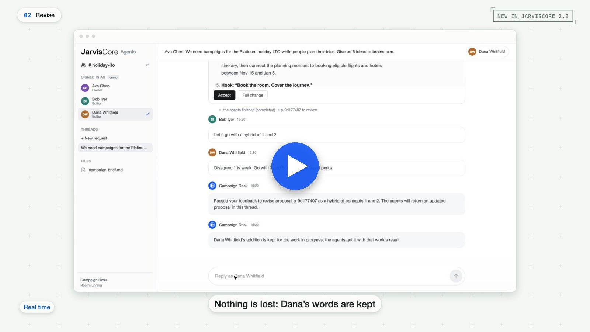

<p align="center">
  
</p>

<p align="center">
  <a href="https://pypi.org/project/jarviscore-framework/"></a>
  <a href="https://jarviscore.developers.prescottdata.io/"></a>
  <a href="https://discord.gg/B2aJV5BJmb"></a>
  <a href="LICENSE"></a>
</p>

# JarvisCore Agents

Complete agent systems built on [JarvisCore](https://github.com/Prescott-Data/jarviscore-framework),
open-sourced as blueprints. Each one is a real team of agents for a real domain, with
its tests and a deterministic demo, and the [Desk](ui/) to run and watch it. Run one,
read how it is built, then copy the shape for your own domain.

<p align="center">
  <a href="https://github.com/Prescott-Data/jarviscore-agents/releases/download/v1.0.0/jarviscore-multiplayer.mp4"></a>
</p>
<p align="center"><sub>
  The <a href="multiplayer/">multiplayer</a> blueprint in the Desk: a real run, model waits sped up.
  <a href="https://github.com/Prescott-Data/jarviscore-agents/releases/download/v1.0.0/jarviscore-multiplayer.mp4">Play the video</a>.
</sub></p>

## The blueprints

| Blueprint | What it does | What it shows |
|---|---|---|
| [Multiplayer](multiplayer/) | A marketing team and its agents plan a campaign in one room. People disagree, add to running work, and decide. | [Rooms](https://jarviscore.developers.prescottdata.io/guides/rooms/): proposals, permissions, nothing anyone adds is lost, people confirm decisions |
| [GTM](gtm/) | Watches your accounts, judges what changed, and does revenue work on request: research, qualification, meeting prep, drafts. | [Durable goals](https://jarviscore.developers.prescottdata.io/guides/goal-execution/), typed results, agent pools, approval before sending or CRM writes |
| [Software Reliability](software-reliability/) | Eight agents map a repository, find a real defect, reproduce it with a failing test, repair it and verify the repair. | [Source workspaces](https://jarviscore.developers.prescottdata.io/guides/source-workspaces/), contracts that hold domain rules, evidence from real runs |
| [Personal Intelligence](personal-intelligence/) | One agent that works for a person: research, plans and errands through the web and their own apps. | [Nexus](https://jarviscore.developers.prescottdata.io/guides/nexus/) credentials, the browser, per-person memory, approval before acting |

Each blueprint is a few files of ordinary JarvisCore: agents, their prompts and
contracts, and a `team.py` that builds the Mesh. There is no orchestrator agent and no
framework code copied in.

## Run a blueprint

You need Python 3.12, [Redis](https://redis.io/docs/latest/operate/oss_and_stack/install/)
and a model key from any provider JarvisCore supports. The Desk also needs Node.js 20.

```bash
git clone https://github.com/Prescott-Data/jarviscore-agents.git
cd jarviscore-agents
python3.12 -m venv .venv && source .venv/bin/activate
cp .env.example .env                 # add one model key
docker run -d -p 6379:6379 redis:7
```

Try the offline demos first. They need no keys or network:

```bash
pip install -e gtm && gtm-demo
pip install -e software-reliability && software-reliability-demo
```

Then run a team in the Desk, for example the one in the video:

```bash
pip install -r ui/requirements.txt -e multiplayer
(cd ui/frontend && npm ci && npm run build)
cd ui && python -m server --config multiplayer.desk.yaml --env-file ../.env
```

Open http://127.0.0.1:8765. Each blueprint's README has its own steps and things to try.

## Build your own

Pick the blueprint closest to your domain and keep its shape: agents with clear
capabilities, contracts for what they return, a `team.py` for the Mesh, a demo that runs
offline, and tests. Replace the domain: prompts, contracts, sources and the effects your
agents may take. The [JarvisCore guides](https://jarviscore.developers.prescottdata.io/guides/)
cover each piece, and [Connect your own Mesh](ui/README.md#connect-your-own-mesh) shows how
to run it in the Desk.

Everything that touches the real world is off until you turn it on: nothing sends an
email, books, buys or changes a record on a fresh clone without a person's approval.

## Contributing and support

These blueprints are published as reference implementations rather than maintained
products, so issues are turned off. Questions, problems and ideas belong in
[Developer Office Hours](https://discord.gg/B2aJV5BJmb), where a person will answer.

Pull requests are open. A new blueprint is welcome when it is one directory, runs its
demo from a fresh clone without keys, keeps side effects off by default, and has tests.
Talk it through in Discord first.

## License

[Apache 2.0](LICENSE), the same as JarvisCore. Nothing here is financial, legal or
professional advice.
